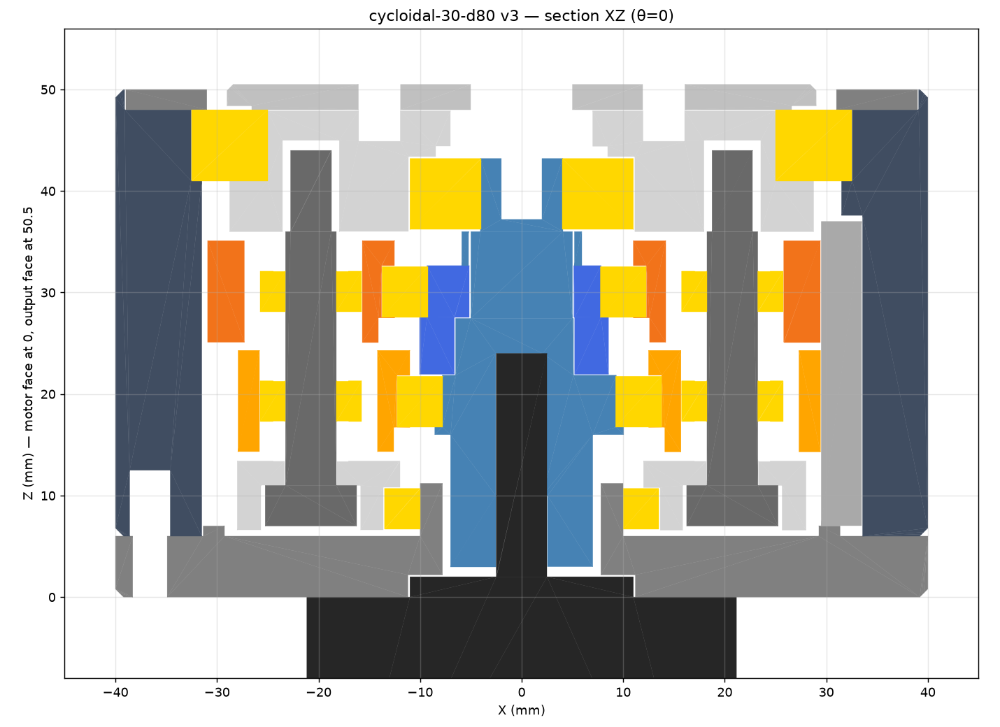

# Cycloidal Drives for a Robot Arm

3D-printed cycloidal reducers for NEMA 17 steppers, built for the joints of a robot arm. This repo is the whole design history: six designs, from a large 50:1 unit down to a compact 30:1 joint that went through three printed revisions and a belt-drive conversion.

> 📸 *Add photos of the printed v2/v3 here: `docs/` is a good place for them.*



## Why

My first prototype **skipped under load**: the printed ring spread and the eccentric deflected until the disc jumped teeth. Every design here attacks that failure mode. The pins are captured in both plates, the eccentric shaft is supported at both ends, and the analysis checks skip torque explicitly, so the drive stalls or strips before it jumps teeth.

## The designs

| # | Folder | Ratio | Size | What it taught me |
|---|---|---|---|---|
| 1 | [`01-cyc50-d138`](designs/01-cyc50-d138) | 50:1 | Ø138 | The real limit is lobe contact stress, not skipping. Ø4 dowels beat rollers at this pin count. |
| 2 | [`02-cyc50-d100`](designs/02-cyc50-d100) | 50:1 | Ø100 | Shrinking the pin circle raises contact stress ~40%, so the rating halves. Bearings had to change, not just scale. |
| 3 | [`03-cyc30-d80-v1`](designs/03-cyc30-d80-v1) | 30:1 | Ø80 | A smaller joint. Fewer pins leave room for fatter ones. |
| 4 | [`04-cyc30-d80-v2`](designs/04-cyc30-d80-v2) | 30:1 | Ø80 | **Printed and assembled.** It could actually be assembled (v1 couldn't), but it was far too stiff, and the hex shaft snapped. |
| 5 | [`05-cyc30-d80-v3`](designs/05-cyc30-d80-v3) | 30:1 | Ø80 | Fit clearances fixed from measurements of the v2 prints, plus a one-piece shaft. v3.1 tightened the pins after they rattled. |
| 6 | [`06-cyc30-d80-belt`](designs/06-cyc30-d80-belt) | 30:1 | Ø80 | The motor moves beside the joint on a 2GT belt, saving 16 mm of height and taking the motor's weight off the back. |

Each folder has its own README with the numbers, bill of materials, print settings and assembly order, plus STEP files for every part.

## How the designs were made

The geometry is **parametric Python** ([build123d](https://github.com/gumyr/build123d)). Every dimension lives in a parameter block at the top of the script, and re-running it regenerates every STEP/STL. Scripts also check the exported geometry: lobe count, pin circle, interference at several input angles, and minimum mesh clearance.

**I wrote the requirements, printed and assembled the parts, tested them, and fed back what failed and what I measured. The models, analysis scripts and per-design READMEs were generated with Claude (AI) from that feedback.** That's why the READMEs inside each folder talk to "you". Some later parts were edited or re-exported by me in Fusion 360. The commit history shows what changed when.

## Re-running a design

```bash
pip install build123d numpy scipy matplotlib trimesh
python designs/05-cyc30-d80-v3/cyc30_v3.py
```

The 50:1 designs include `setup.ps1` / `setup.sh` to build a virtual environment and run everything.
